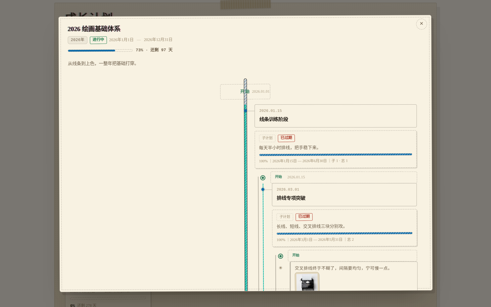
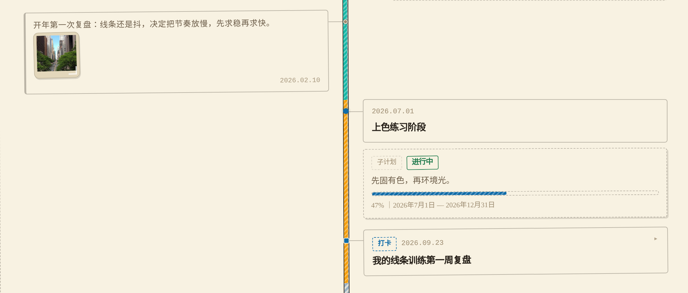
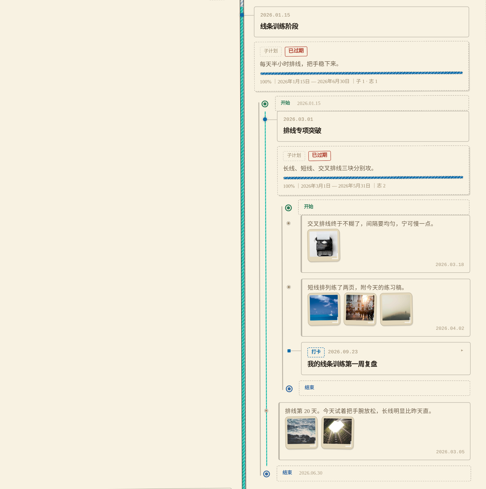
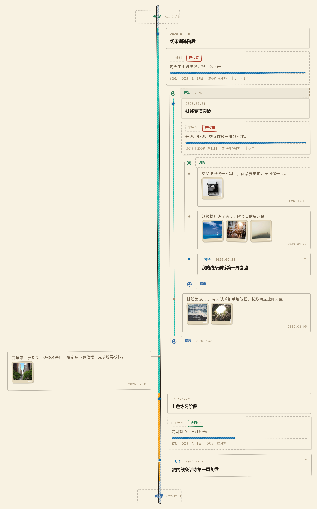

# GrowthPlan · 成长计划插件




一个 Typecho 成长计划管理插件。后台自定义计划类型（技能 / 目标 / 旅行…），每条计划带年份和起止日期，**进度条按「已过天数 / 总天数」实时计算**；前台是一套按类型分组的**卡片式视图**，自动区分未开始 / 进行中 / 即将到期 / 已过期 / 已完成。

前台是一套**卡片网格 + 纯 CSS 弹窗 + 主干居中的时间线**：每条顶级计划一张卡（封面图 + 标题 + 状态 + 迷你进度条），**点整张卡**弹出一条**树状混排时间线**——**主干竖线居中**，**「开始 / 结束」两张小路牌挂在线的两端（线的上 / 下方，不压线）**，**左边只挂日志记录**，右边挂文章打卡、历史轮次、子计划，两侧卡片各连一条横向短线到主干。**子计划节点默认就是展开的**，它的下级（子时间线 + 自己的日志）直接铺在父卡片里，一层套一层；**日志卡**只放正文 + 缩略图 + 右下角日期，点缩略图铺出大图；**点打卡节点**展开文章摘要与原文链接。全程靠 CSS 的 `:target` + 原生 `<details>` 切换，**零 JavaScript**，禁用 JS 也照样能用。

还支持**任意层级的子计划**和**带图日志**：一个大计划下面可以插任意多个小任务，小任务下面还能继续拆，**层级不限**——子计划默认展开，它的下级（孙计划时间线 + 自己的日志）直接铺在父卡片里，一层套一层；每个计划都能按天写一段感想（**就是「记录」节点本身**）并配上图片。

计划到期或完成后，可以**归档**收起，也可以**继续计划**——把当前这一期封存成历史轮次，拉长未来的时间线，进度按**累计不清零**计算，适合「一轮又一轮持续精进」的长期目标。归档后的计划会收进页面底部的**「归档」区块**，主时间线只留进行中的。

还支持**写文章打卡**：写文章时在编辑器的「高级选项」里勾选想关联的成长计划（**支持多选**），发布后这篇文章会自动变成对应计划时间线上的一枚**「打卡」节点**——点开看摘要，想读全文再点「阅读全文」跳过去。**改标题、撤稿、删文章，时间线全部自动跟着变**，不需要任何手动同步。

---

## 一、安装

> 环境要求：Typecho 1.2+、PHP 7.4+（推荐 8.x）。插件跟随站点的数据库，SQLite / MySQL 均可用。

### 1. 上传插件

把仓库里的两个文件放进站点的插件目录（没有就新建一个名为 `GrowthPlan` 的文件夹）：

```
你的站点根目录/usr/plugins/GrowthPlan/
├── Plugin.php      # 插件主体：建表、迁移、面板注册、进度与状态计算
└── manage.php      # 后台管理面板
```

### 2. 上传前台模板

把仓库 `templates/` 里的 `page-growth.php` 复制到**当前启用主题**的目录下（文件名保持 `page-growth.php` 不变）：

```
你的站点根目录/usr/themes/<你正在用的主题>/page-growth.php
```

> 注意：是复制到**你实际启用的主题**目录，不是 `default`。文件名保持 `page-growth.php` 不变。

### 3. 启用插件

进入后台 **控制台 → 插件 → 找到「GrowthPlan 成长计划」→ 启用**。

启用时会自动：

- 创建六张数据表 `typecho_growth_categories`、`typecho_growth_plans`、`typecho_growth_logs`、`typecho_growth_log_images`、`typecho_growth_rounds`、`typecho_growth_plan_posts`（表前缀跟随你的配置）
- 对已存在的旧表做**增量迁移**（补 `parent_id` 列与索引、补 `archived` 列、补 `cover` 列、补轮次表、补文章打卡映射表），老数据不受影响
- 注册「文章发布 / 保存 / 删除」三个钩子，并在写文章页注入「关联成长计划」选择框
- 写入默认配置
- 在后台左侧菜单加一项「成长计划」

启用后打开后台 **成长计划** 菜单，插件会**自动创建名为「成长计划」的独立页面**（缩略名 `growth`），前台地址一般是 `/growth.html`。页面底部会显示「独立页面已创建」以及可点击的前台预览链接。

> **从旧版本升级**（已经装过、但没有归档/续期功能的版本）：后台先**停用**插件 → 用新文件**覆盖** `usr/plugins/GrowthPlan/` 和主题里的 `page-growth.php` → 再**启用**。启用时会自动补列补表，已有计划与类型都在。停用插件不会删任何数据。
>
> 如果只是替换了文件、没重新启用，插件也会在每次打开面板时**静默兜底迁移**（补 `archived`、`cover` 列与轮次表），所以直接覆盖文件通常也能用。

---

## 二、使用

### 后台「计划」页

- **顶部 chip**：按类型、按年份快速筛选
- **计划列表**：树形展示，子计划带 `└` 缩进挂在父计划下面，标题下方会标出「子计划 N 条」
  - 列：ID / 计划 / **封面** / 年份 / 起止日期 / 进度 / 状态 / 排序 / 操作
  - 进度条与百分比由起止日期实时算出
  - 「排序」列可直接改数字点保存，即时生效
  - 「继续」（续期）是一个锚点，点了会在表格下方展开续期面板（见「继续计划」一节）
- **添加 / 编辑计划**：计划标题、所属类型、**父计划（可选）**、目标年份、开始日期、截止日期、状态、排序、**封面图**、描述

#### 封面图

前台是一张卡片网格，卡面上半部分就是这张图。

- **图片链接**：可以粘外链，也可以点「上传」从本机选图，上传完自动回填链接并刷新预览
- 输入框下面有一小块预览，填了链接就能立刻看到效果
- **留空也可以**，前台会退化成「类型色竖条 + 计划首字」的占位图，不会出现空白框

> 链接会做净化，只放行 `http(s)://`、`//` 协议相对地址、站内 `/` 开头的路径，以及没写 scheme 的裸域名（补成 `https://`）。`javascript:` 之类的会被丢掉。长度上限 500 字符。

#### 子计划（任意层级）

「父计划」下拉里用缩进把整棵树铺开，想挂多深就挂多深，没有层数上限。

- 新增时选一个父计划，它就成了子计划；选「— 顶级计划 —」就是顶层
- 编辑时**下拉里不会出现它自己和它自己的所有后代**——这是刻意的，防止把父计划挂进自己的子树里造成死循环
- 就算绕过前端直接构造表单提交，后端也会再拦一次，非法请求会被拒绝并提示「不能把计划挂到自己或自己的子计划下面」
- 父计划不存在时也会被拒绝，不会产生悬空数据

> 前台渲染是**递归**的：子计划有自己的日期、进度条、状态和日志。父计划时间线上子计划节点默认展开 → 直接看到它的子时间线 → 子时间线里的孙计划同样展开，**层级不限**。

> **进度怎么算**：进度 = 已过天数 ÷ 总天数。想让进度准确，**开始日期和截止日期都填上**；只填截止日期时，开始日期按「今天」算。
>
> 起始日 = 截止日 → 100%；完全还没开始 → 0%。

### 后台「计划日志」

计划列表下方就是日志管理区。**大计划和小任务都能写日志**，按天记录。

- **顶部 chip**：切换要看哪个计划的日志，每个 chip 后面带该计划的日志条数
- **日志列表**：日期 + 所属计划 + 正文 + 配图缩略图（缩略图下方显示说明文字），右侧是「编辑 / 删除」
- **写一条日志**：所属计划、日志日期、排序、这段感想、配图

#### 配图

每张图两个字段：**图片链接** + **文字说明**。

- 链接可以直接粘外链，也可以点「上传」从本机选图，上传完会自动回填链接
- 上传走的是插件自带的 AJAX 接口，不刷新页面，上传成功/失败会在按钮旁提示
- 行数默认为 3 行，点「+ 再加一张」可以继续加
- 点「移除」是**清空这一行**而不是删掉行（所以序号不会错位），链接留空的行保存时会被自动丢弃

> 说明文字留空也可以 —— 只是点开放大的那张图下面不会显示说明。

### 后台「类型」页

- 类型列表：类型名（含彩色圆点）、说明、排序、计划数
- 可**改名、改排序、删除**
- **添加类型**：类型名、说明、颜色（`#rgb` / `#rrggbb`，会用作前台分组标题的小圆点）、排序

> **删除类型不会删计划**。该类型下的计划会自动归入「未分类」，不会丢数据。

### 后台「插件设置」

| 选项 | 说明 |
|---|---|
| 前台显示 | 关闭后前台只显示提示文案，不输出任何计划内容 |
| 即将到期阈值 | 距截止日期 N 天内标记为「即将到期」，默认 30 天 |
| 状态标签 | 是否在前台显示状态标签 |
| 年份筛选 | 是否在前台显示年份筛选条 |
| 开始节点颜色 | 时间线首端「开始」节点的颜色，取色器选择，非法值自动回落默认 |
| 结束节点颜色 | 时间线末端「结束」节点的颜色，同上 |
| 关闭时的提示文案 | 前台开关关闭时显示的文案 |
| 无计划时的空状态文案 | 前台一条计划都没有时显示的文案 |

> 提示文案**清空输入框**即回落到内置默认文案。

### 删除计划会连子计划一起删

删除一个有子计划的计划时，确认框会告诉你「它下面的 N 个子计划以及全部日志会一起删除」。确认后：

- 整棵子树的计划全部删除（任意深度）
- 这些计划下的**所有日志**删除
- 日志配的**图片记录**一并删除
- 这些计划的**历史轮次记录**也一并删除

> 这是**不可撤销**的操作，删之前请确认。

### 归档 / 继续计划

计划完成后（或暂时不想让它占着主时间线），在后台「计划列表」的**操作列**有两个按钮：**继续** 和 **归档 / 恢复**。

#### 归档

点「归档」会把计划从主时间线上摘出去。

- **只改一个标记，绝不删任何数据** —— 日志、配图、轮次全都在
- **整棵子树跟着一起归档**：父计划归档了，它下面的子计划也一起收起来。确认框会告诉你「它下面的 N 个子计划也会一起归档」
- 归档后那一行会**整体压淡**并打上「已归档」标签
- 再点一次「恢复」，父计划和子计划一起回到主时间线
- 归档和「已完成 / 已过期」是**两回事**：一个计划可以既已归档、又是已完成状态，两者互不影响

> 归档只影响**展示**，不影响任何计算。归档的计划进度该是多少还是多少。

#### 继续计划（续期）

点「继续」会展开一个小面板，里面预填好了日期：

- **新周期标题**：默认沿用原标题，可改
- **开始日期**：默认「今天」
- **截止日期**：默认「保持原有跨度、从今天往后推」（比如原来是 90 天，就填到 90 天后）

确认后会发生两件事：

1. **当前这一期被存档为一条历史轮次**（记录标题、起止日期、总天数、已过天数）
2. **计划的时间线被拉长**到新的起止日期，年份自动跟着更新，同时**自动解除归档**、状态回到「未完成」

> 起止日期都可以在面板里手改；跨度会按你填的日期重新计算，所以不一定非要和上一期一样长。

轮次号是**自动累加**的：第一次续期存成「第 1 轮」，第二次是「第 2 轮」，以此类推。

#### 进度怎么算：累计不清零

续期后，进度条分两个口径：

| 位置 | 口径 | 例子 |
|---|---|---|
| 卡片上的进度条 | **本轮**：只看当前这一期的已过 / 总天数 | 本轮 17% |
| 进度条下方的累计提示 | **累计**：历史轮次 + 当前本轮 | 累计 386 天／总计 487 天｜79% |

- **卡片进度条仍按本轮算**——它要跟「还剩多少天」对应，用累计值会前后矛盾
- **累计值单独一行显示**，只有存在历史轮次时才出现
- 封轮时会把「已过天数」**定格**，所以历史轮次之后再看数字不会随日期漂移

> 前台每条计划的时间线模态里，「第 N 轮」会作为一枚节点出现在时间线上；写了备注的轮次可以原地展开看备注，没写备注的轮次节点信息（起止、天数、完成度）直接铺在卡片上。

### 状态自动判断

| 状态 | 触发条件 |
|---|---|
| 未开始 | 今天 < 开始日期 |
| 进行中 | 在区间内，且距截止 > 阈值天数 |
| 即将到期 | 在区间内，且距截止 ≤ 阈值天数 |
| 已过期 | 今天 > 截止日期 |
| 已完成 | 手动把计划状态设为「已完成」（优先于以上自动判断） |

> **状态选项就两个：未完成（默认）/ 已完成**，后台随时可改。
> 「已过期」只可能出现在**未完成**的计划上 —— 计划做完了就把状态标成
> 「已完成」，超期后依然显示已完成，不会被标成已过期。

### 文章打卡（把文章挂到计划上）

在**写文章**页面，右侧「**高级选项**」里会多出一栏「**关联成长计划（打卡）**」，里面是全部计划的列表框（子计划带 `——` 缩进，看得出归属）。按住 `Ctrl` / `Cmd` **可以多选**，一篇文章挂几个计划都行。

- **发布**后，这篇文章会作为一枚「打卡」节点出现在**每一个**被勾选计划的时间线上
- **编辑**已发布的文章时，已勾选的计划会自动回显，改完再发布即生效
- 想**取消**某篇文章的打卡，编辑它、把对应计划取消勾选、再发布即可
- 想**彻底摘掉**，把文章改成「隐藏 / 私密」或直接删除，节点都会自动消失

> **它是怎么做到「自动同步」的**：
> 插件只存一张**映射表**（哪篇文章关联了哪些计划），文章标题、日期、状态**从不复制**——时间线渲染时会 `INNER JOIN` 文章表**实时读取**，而且只认 `status = 'publish'` 的文章。
> 所以：**改标题** → 节点标题立刻变；**撤稿**（改成隐藏/私密）→ 节点立刻消失；**删文章** → 节点消失、映射行自动清理；**重新发布** → 节点自动回来。全程**零额外同步逻辑**，没有「点了同步按钮才更新」这种事。

前台时间线上的打卡节点长这样：

- **方形圆点**（▢）——和圆形的「子计划 / 日志」、大圆形的「开始 / 结束」一眼区分开
- 卡片上带一枚「**打卡**」标签 + 文章标题 + 发布时间
- **点一下原地展开**：里面是文章摘要（约 120 字的纯文本），底部一行「**阅读全文 →**」蓝色链接
- 「阅读全文」在新标签页打开原文，**不会**把你从计划页面带走

> 卡片按「日期升序」和轮次 / 子计划 / 日志混排在同一条时间线上；同一天的话，排的顺序是：轮次 → 子计划 → 日志 → **打卡**。

---

## 三、前台展示






前台页面（默认 `/growth.html`）采用**卡片网格 + 纯 CSS 弹窗**：

- 网格里每条**顶级计划**是一张卡，卡面是封面图 + 标题 + 状态徽标 + 迷你进度条
- **点整张卡片** → 弹出一条悬浮的**时间线模态**，把这条计划的起止节点 / 子计划 / 日志 / 历史轮次混排成一条**树状时间线**：竖线居中、两侧卡片各接一条横线到主干，首尾路牌挂在线的两端（不压线）
- **子计划节点** → **默认展开**，直接铺出它自己的子时间线（含自己的起止节点），可以继续往下，**层级不限**
- **点日志缩略图** → 铺出大图层看大图，再点一下关掉、回到原时间线
- **点打卡节点** → 原地展开文章摘要，底部「阅读全文 →」在新标签页打开原文
- 全程**零 JavaScript**：模态靠 CSS 的 `:target` 伪类、展开靠原生 `<details>`，禁用 JS 后功能完全不受影响（打卡的关联选择在后台，属于 Typecho 后台表单，不影响前台零 JS）

### 页面结构

1. **页头概览**：共 N 条计划，分布在 M 个类型；各状态计数
2. **视图切换**：「主时间线」/「归档区 N」两个 chip（归档区为空时不显示）
3. **年份筛选条**：「全部」+ 各年份 chip（带计划数）
4. **按类型分组**：每个类型一个标题（带类型色圆点）+ 说明
5. **卡片网格**：类型下面是一组计划卡片

> **只有顶级计划进网格**。子计划是「父计划时间线上的节点」，不进网格 —— 否则网格里既有「计划」又有「阶段」，两类东西视觉权重还一样，看不出主次。
>
> 例外：父计划被年份筛选掉时，子计划会被当作顶级返回并出现在网格上，不会丢行。

### 卡片长什么样

| 区域 | 内容 |
|---|---|
| 卡面上半部分 | **封面图**（16:10 裁切）。没填封面时用类型色画一个占位：左侧类型色竖条 + 计划首字 |
| 卡面下半部分 | 标题（最多 2 行）、迷你进度条 + 百分比、子计划数 / 日志数提示 |
| 卡面右下角 | 年份徽标 + 状态徽标（白底深字，压在封面图的渐变托底上） |

**封面图**在后台计划表单里填，两个字段任选：

- **图片链接**：可以粘外链，也可以点「上传」从本机选图（上传完自动回填链接）
- 留空即可，前台会自动画类型色占位，不会出现空框

封面链接会做净化：只接受 `http(s)://`、`//`（协议相对）、站内 `/` 开头的路径，以及没写 scheme 的裸域名（会补成 `https://`）。`javascript:` 之类的协议会被丢掉。

### 点卡片 → 时间线模态

**纯 CSS，零 JS**：卡片本身是 `<a href="#gp-mN">`，模态是 `<div class="gp-modal gp-modal-lv1" id="gp-mN">`，靠 `:target` 点亮。

- 点**卡片任意位置**都算（卡片整块就是一个 `<a>`）
- 所以中键新开标签页、右键复制链接、键盘 <kbd>Tab</kbd> 聚焦 + <kbd>Enter</kbd> 打开全都天然可用
- 模态里的遮罩、右上角的 ✕ 都是「指回网格锚点 `#gp-grid`」的链接，纯 `:target` 切换
- **浏览器返回键也能关闭**（`hashchange` 天然进历史记录）
- 模态用 `display: none → flex` 切换，**不用 `visibility` / `opacity`** —— 那样隐藏的模态仍然会参与 <kbd>Tab</kbd> 焦点顺序，键盘用户会掉进看不见的弹窗里

> ⚠️ 关闭锚点必须有实体元素落点：`href="#gp-grid"` 对应的 `<span id="gp-grid">` 是真实存在的（宽高为 0 的隐藏元素）。没有落点的话浏览器找不到锚点，会滚到页面底部。

模态里显示这条计划的**封面、标题、年份、状态、起止日期、完整进度条、累计进度、描述**，下面是**一条主干居中、左右分侧挂节点**的全宽时间线。

### 弹窗是一条中线：日志在左，文章在右

主干竖线**居中**，一行 = `[左卡片] ┃主干┃ [右卡片]`，两侧卡片挂在**同一根线**上，各自从圆点接一条横线出来。

| 位置 | 放什么 | 长什么样 |
|---|---|---|
| **主干上（居中）** | 开始 / 结束 | **小卡片骑在线上**，不带圆点，卡片自己就是节点标记 |
| **主干左侧** | **只有日志** | 小卡片只放正文 + 缩略图 + 右下角日期 |
| **主干右侧** | 文章打卡、子计划 | 卡片挂在右边，标题 + 摘要，点开看全文 |

> ⚠️ **本版没有「左侧日期列」了。**
> 原来左侧有一列 78px 宽的日期（右对齐排成一列），所有左侧节点的日期都挂在那里。
> 本版把**日志的日期挪进了卡片右下角**，这一列就没人用了 —— 留着是一条空列，
> 白白把主干推到 420px、挤掉两侧卡片宽度。所以整列砍掉，`date-w = 0`。

#### 日志卡片（本版重做）

日志和右侧文章卡是**两种不同的卡**，视觉上一眼能分开：

| | 文章卡（右） | 日志卡（左） |
|---|---|---|
| 顶部标签行 | 有「打卡」标签 | **无** |
| 标题 | 有 | **无** |
| 正文 | 摘要 | **全文**（随手记本来就短） |
| 图片 | 无 | **缩略图一排，点击放大** |
| 日期 | 标题行内 | **卡片右下角** |
| 展开交互 | 点开看摘要 | **没有展开这一层** |

日志卡刻意做得更素（更小内边距、更小字号、左侧一条中性灰色条），
不再有「记录」标签行、不再有展开箭头 —— 因为日志本来就是「一段随手记」，
一屏看尽比折叠起来更合适。有配图时**直接铺出缩略图**，
不用再点一下才能看到图。

#### 配图放大：点击铺出大图层

缩略图是 `<a href="#gp-shot-<id>">`，点它把 `:target` 切到对应的 `.gp-lightbox`，
大图铺满视口；点大图任意处或右上角 ✕ 关闭，**回到原时间线**（不是被甩回列表）。

> **为什么从「悬浮放大」改成「点击放大」？**
> 悬浮放大在**触摸屏上根本触发不了** —— 手机上永远看不到大图。
> 而且悬浮时大图盖在正文上，想边看图边读字做不到。
> 点击 → `:target` 铺出独立一层，看着更稳，手机也能用。
>
> **为什么不用 `<details>`？**
> `<details>` 要求「点 summary」，而缩略图本身是个链接（要能点开），两者语义冲突。
> `:target` 天然就是「点链接 → 显示目标」，最贴合这个场景。

### 开始 / 结束：小路牌挂在线的两端（2026-09 定稿）

首尾两个节点不属于左也不属于右，放在正中当**路牌**：**「开始 / 结束」在上、日期在下，两行居中**，分别挂在主干最顶端的上方、最末端的下方 —— **不压线、不切日期**，和线端之间留一段净缝（实测 ≥12px）。

实现上有个必须注意的点：卡片宽度是 `auto`（内容撑），想让它的**中轴**落在主干上，用 `margin` 是算不出来的（要先知道卡片多宽，而它是 `auto`）。所以走**绝对定位 + transform**：

```css
.gp-tl-item.side-c > .gp-tl-card{
  position:absolute;
  left:var(--gp-rail);          /* 卡片左缘先钉在主干上 */
  transform:translateX(-50%);   /* 再整体左移半个自身宽度 → 中轴正好落在主干 */
  white-space:nowrap;           /* 路牌是「两行字」，各自不许折行 */
}
.gp-tl-item.side-c{ padding-top:30px; padding-bottom:16px; }  /* 绝对定位会让 li 塌成 0 高，靠 padding 撑行高 */
```

同时**主干竖向收边**：胶囊壳不再顶到底，而是 `top:80px / bottom:86px` —— 给上下两张路牌让出位置，线从路牌下方开始、到路牌上方结束。

#### 几个踩过的坑（都实测过）

1. **绝对定位会让 `<li>` 塌成 0 高**，下一行的卡片直接叠上来。必须用 `padding-top/bottom` 把行高重新撑起来。
2. **`width:max-content` 遇上 `max-width` 会在内部折行**。路牌文案必须 `white-space:nowrap`；`.gp-tl-head` 全局是 `flex-wrap:wrap`，也要在居中节点上强制 `nowrap`。
3. **`position:relative` 会在同特异性下静默盖掉上面的 `position:absolute`**（后写优先）。改动这一块时每次都要核对这对声明，不然卡片会掉回文档流、重新压到线上 —— 实测踩过一次，排查了很久。
4. **子层和窄屏都不能居中，必须退回右挂**。居中 = 卡片中轴对主干，而深层子线的 `rail` 只有 `10px`（主干贴左缘）—— 此时「中轴对 10」等于卡片左移自身一半宽度，整段会跑出父卡片。所以 `depth ≥ 3` 与 `≤640px` 下都撤销绝对定位、回到普通流、从主干右侧起排。
5. **区段色带的端头要「收圆」**（详细见下一节）：方端头会从胶囊圆头外多冒一截，两端像被切平。

### 主干是空胶囊：子计划给时间线上色（2026-09 定稿）

竖向主干不再是一根 1px 细线，而是 **9px 宽的空胶囊**：`--gp-ink` 色边框（深浅主题都可见）、圆角 999px、内部默认**蓝色斜条纹** —— 「没有被任何子计划覆盖」的底色。

每条子计划在**它自己的起止日期范围内**给胶囊刷上自己的颜色；**后添加的子计划从它的开始日期起覆盖旧颜色**（同日开始时 id 大者赢）。没人覆盖的区间露出默认蓝条纹。

实现是纯 CSS、零 JS：渲染时间线时逐条目算出「它落在哪个子计划的区间里」，把颜色挂在 li 的 `--gp-seg` 上，li 用 `::before` 在自己的行高内刷色 —— 相邻行的段上下相接就是连续色带。胶囊壳由 `.gp-tl::before` 画。

四个必须注意的点：

1. **外径 9px = 圆点直径**。圆点正好当珠子卡在胶囊上，连接线端点（rail±4.5）正好抵住胶囊两壁 —— 所有几何常量（4.5 的偏移）一个都不用改。
2. **`--gp-seg` 会沿 DOM 继承**：子时间线嵌在父计划的 li 里，不重置的话嵌套线全被父色淹没。所以 `.gp-tl{--gp-seg:transparent}` 逐层清零，每条时间线只按**它自己的**子计划染色。
3. **调色板刻意没有蓝色**（青/琥珀/玫红/绿/橙/粉按子计划创建顺序循环）—— 蓝是默认底色，子计划撞蓝就分不清哪段有主了。
4. **首尾内容行的色段端头要「收圆」**。主线胶囊的两端各挂着一张路牌，竖壳收在 `top:80px / bottom:86px`（给路牌让位）；色段默认 `top:0 / bottom:0` 铺满行高，端头会在胶囊圆头之外冒出一截方形色块，两端像被切平、长了个方接头。正解：首末内容行的色段端点**内缩 1.5px（= 胶囊边框厚）、加 3px 圆角（= 内壁圆头半径）**，方角正好落进圆头内壁。

> 区段按「条目日期是否落在子计划区间」判定，**不是按几何位置** —— 所以色带的边界永远落在子计划节点（它的开始日期）上，语义和视觉一致。

### 子时间线：d2 保持双列，d3 起退回单侧（并且**不走胶囊**）

- **第 2 层（子计划的子时间线）保持和主层同构的中线布局**：主干居中，**日志在左、打卡在右**，两侧卡片各接一条横向短线 —— 打开一张子计划卡片，视觉语言和主时间线一致，不需要重新学一遍。
- **第 3 层起退回「单侧」**：父卡片本身只有 300px 出头宽，再往下还坚持 `date + 左卡 + 主干 + 右卡`，左侧卡片会被 `calc()` 算成负数宽度，直接塌成几十像素的竖条。所以 `depth ≥ 3` 统一**主干贴左、所有节点列在右侧**，靠逐层右移 + 圆点逐层变小表达从属关系。
- **层级标签跟随深度**：节点卡片的标签会显示「子计划 / 孙计划 / 曾孙计划 / 玄孙计划」，缩进再深也能一眼分清哪层是哪层。
- **窄屏（≤640px）整体退回单侧**：390px 的屏，主干居中后左右各分不到 100px，两边卡片都会被压成竖条。主干贴左后卡片能拿到 300px+，正文读得下去。
- **中间档（≤1080px）仍保持中线**：rail 是 `50%` 百分比，面板收窄到 `96vw` 时主干自动跟着容器正中走，不需要再换算像素。

> ⚠️ **子线的主干不能再用「胶囊」，必须退回 2px 细轨。**
> 这是个真实踩过的坑：一个带 3 个子计划的主计划，渲染出来是**4 根并排的粗胶囊**
> （父线 1 根 + 每个子计划内嵌 1 根），层层缩进堆成「楼梯」，整块排版看着就是乱的。
> 胶囊壳 `.gp-tl::before` 是通用规则，子层也照单全收 —— 得显式覆盖：
>
> ```css
> .gp-tl-d2::before, .gp-tl-d3::before, .gp-tl-d4::before{
>   left:calc(var(--gp-rail) - 1px); width:2px;
>   border:0; border-radius:0; background:var(--gp-line-2);
> }
> ```
>
> 「父线粗胶囊 + 子线细轨」这个对比本身也把层级关系讲清楚了，比层层都用胶囊更清楚。

> ⚠️ 断点里改几何**只能写 `.gp-tl-d1`，绝不能写 `.gp-tl`**。
> 内联样式优先级高于任何选择器，唯独压不住 `!important`；断点里一句
> `.gp-tl{--gp-rail-base:340px !important}` 会把**所有层级**的 rail 一起改掉，
> 子层内联的 `10px` 被无声覆盖，子卡片立刻塌成竖条 —— 而且不报错、不显形。
> 这个坑真踩过一次，验收脚本里专门留了一条断言防复发。

### 几何怎么算

所有位置都由**四个变量**推导，不散落写死：

| 变量 | 含义 |
|---|---|
| `--gp-date-w` | 日期列宽度（只有左侧节点用） |
| `--gp-rail` | 主干 x，也是圆点中心的 x |
| `--gp-pad` | 左卡片右缘与主干之间的**额外**留白（默认 0） |
| `--gp-right-w` | 右卡片右边界到 ul 右缘的距离（默认 0 = 铺满） |

```
圆点 left（li 坐标） = rail - 半径        （li 满宽，左缘与 ul 对齐）
左卡片左缘           = date-w + 10
左卡片右缘           = rail - link - 4.5 - pad
右卡片左缘           = rail + link + 4.5
```

`--gp-link` 是横向连接线长度，**固定 22px**，不做成 `pad - rail` 的差 —— 中线布局下这个差动辄两三百像素，直接当线长会画出一条横贯半屏的直线，把「从属小短线」变成视觉噪音。

> **两层壳：`--gp-*-base` + `var()` 派生。**
> PHP 只内联**基准值**（`--gp-date-w-base` 等），CSS 里写
> `--gp-rail: var(--gp-rail-base, 300px)` 派生实际值。
> 这样媒体查询才能正常覆盖 —— 直接内联 `--gp-rail` 的话，
> 内联优先级最高，窄屏那套调整会一个字都不生效（老版本就是这样一直静默失效的）。

#### 圆点为什么都是奇数直径

`.gp-tl-dot` 9px / `-4.5px`、`.gp-tl-dot-log` 7px / `-3.5px`、`.gp-tl-dot-edge` 11px / `-5.5px` —— **直径一律取奇数、偏移一律取半径（半像素）**，中心才会落在同一个格上。早先写成 8px / `-4px`，数学上中心也是 `rail`，但奇偶像素取整后差半像素，放大看能看出「这颗点比别的偏了一点」。

### 时间线怎么混排

**子计划、日志、历史轮次三类条目全部混在同一条竖线上**，按日期统一排序：

| 条目 | 日期取自 | 节点样式 |
|---|---|---|
| **开始 / 结束** | 计划的起止日期 | 大号色圈（颜色后台可配），永远钉在这条线的最顶端和最末端 |
| 历史轮次 | `start_date` | 灰实心点 + 「第 N 轮」 |
| 子计划 | `start_date` | 实心圆点 + 迷你进度条，**默认展开、不给折叠开关** |
| 日志 | `log_date` | 最小灰点 + 完整正文 + 「附 N 张图」提示，**有图可展开** |

排序规则（按优先级）：

1. **无有效日期的一律沉底**（空串、`0000-00-00` 都算无日期）
2. **日期升序：旧 → 新**，即时间线从上往下是「从过去到现在」
3. 同一天按 **轮次 → 子计划 → 日志** 排：轮次是「这一期从哪天开始」的框架事件，先立框架再看细节；日志是当天的随手记录，沉在当天最下面最自然
4. 同一天同一类，保持录入顺序

> 为什么要重排：三类数据从库里出来时顺序各不相同 —— 日志是 `ORDER BY log_date DESC`（降序），轮次是 `round_no ASC`，子计划是 `ORDER BY year DESC, end_date ASC`（压根没按 `start_date` 排）。直接拼在一起必然是乱的。

节点上的文字**不截断**，完整铺开。时间线是「读」的地方，不是「扫」的地方，截成一行再加省略号会逼用户点开才知道写了什么，反而多一次交互。

### 点节点 → 原地展开（不再有二级弹窗）

时间线上的节点**不再跳第二层弹窗**。能展开的节点用原生 `<details>/<summary>`：点一下 summary，内容就在节点正下方展开；再点一下收起。

| 节点 | 展开出来的内容 | 默认状态 |
|---|---|---|
| **子计划** | 它自己的一条**子时间线**（含自己的「开始 / 结束」节点），下级内容全在里面 | **默认展开，不给折叠开关** |
| 日志 | **没有展开这一层** —— 正文 + 缩略图直接铺在卡片里 | —— |
| 打卡 | 文章摘要 + 「阅读全文 →」 | 收起 |
| 日志（无图）/ 轮次（无备注） | 不给展开箭头 —— 展开个空盒子没有意义 | —— |

> **子计划为什么默认展开、连箭头都不给？**
> 点进一条计划的人，本来就是来看「这条支线做了什么」。再让他多一次点击才能看到内容，纯属多一道手续。所以子计划用 `<details open>` 渲染 —— **保留可折叠的语义与可访问性结构**（哪天想改回可折叠，去掉一个属性就行），但视觉上不出现箭头、也不给「可点击」的暗示，它看起来就是一张铺开的卡片。
> 留 `<details>` 而不是换成 `<div>` 的另一个好处：展开/收起的逻辑、键盘可达性、屏幕阅读器语义全都是浏览器原生给的，一分钱不花。
>
> **日志同理，也改成默认展开。**
> 写日志的人**特意配了图，就是要给人看的**。再让他点一下才看到图，等于把内容藏起来。
> 所以有图的日志和子计划走同一套：`<details open>` + 不给箭头
> （`.gp-tl-details-open > summary.gp-tl-card{ cursor:default; }`），视觉上就是一张铺开的卡片。
> 没图的日志仍然不给 `<details>` —— 展开区里放的就是配图，没图时展开是个空盒子。

为什么放弃二级弹窗改用原地展开：

- **不再抢 `:target`**。旧方案里打开二级必然关掉一级（`:target` 全局唯一），想「开着父时间线对照着看子计划」做不到；现在展开多少个都行，上下文一直在
- **键盘免费**。`<summary>` 是原生可聚焦元素，<kbd>Tab</kbd> + <kbd>Enter</kbd>/<kbd>Space</kbd> 直接可用，不用自己补键盘逻辑
- **零 JS 底线不动**。`<details>` 是浏览器原生行为，比 `:target` 还少一层依赖

三条实现上的硬约束（都实测过，违反任意一条就展不开且完全不报错）：

1. **summary 里不能放 `<a>`**——链接会抢走点击，`details` 根本展不开；所以节点卡片从 `<a>` 换成了 `<summary>` 本身
2. **`<summary>` 必须是 `<details>` 的第一个子元素**，前面插任何东西折叠都会失效
3. **`summary { display: flex }` 会吃掉原生三角**——需要自绘箭头（▸ / ▾）的节点（日志、打卡、轮次）都得自己画；子计划不需要箭头，所以那条规则对它不适用
4. **`<details open>` 的展开区仍然要在 `.gp-tl-open` 里** —— `open` 只是初始状态，结构约束（summary 第一个、内容在 summary 之后）一条都不能松

### 无限层级：子时间线就地铺开

子计划在父时间线上只是一个**节点**。如果把它的下级只写成「子 N · 志 N」这样一个数字，那些**孙计划就整页没有入口**了 —— 标题、正文、进度全都看不到。

所以**子计划节点默认就把自己的那条线铺出来**（`<details open>`，不需要点）：

```
大计划的主线（第 1 层竖线）
  └─ 子计划节点（默认展开）
       ├─ 第 2 层竖线（与第 1 层平行、更靠右）
       │    ├─ 它自己的「开始 / 结束」节点
       │    ├─ 孙计划节点展开 → 第 3 层竖线 → …（任意深度）
       │    └─ 它自己的日志节点
       └─ （主线上其余节点继续）
```

- **层级不限**：每一层展开都是同一套结构递归下去，深到多少层都能走
- **竖线永远向右并列、不穿越父线**：子线的 x 坐标 = 父缩进 + 子缩进 + 子线偏移，恒大于父线；想要「子线落在父线左边」在几何上根本不成立（线会横穿父线）
- **几何全部走 CSS 变量**（`--gp-rail` / `--gp-pad`），圆点、竖线、短线的位置都从这两个变量推导，不在 CSS 里散落手写数字 —— 早期版本三处手写数字互相耦合，出现过 1px 的错位，变量化后各层恒定对齐
- **第 3 层起收掉日期列**：再往右卡片宽度撑不住，日期信息在卡片内部的起止行里本来就有，不丢内容
- 下级只挂**直属**的（自己的日志 / 自己的子计划），防环由渲染前的 `seen` 表兜底

### 归档：页面底部的常驻区块

- 主时间线**只显示未归档的计划**；归档的计划收进页面最底部的**「归档」区块**（和类型分组同款样式，一条虚线分隔）
- **归档整条子树**：父计划归档时，子孙计划跟着一起走（后台按 `parent_id` 收整棵子树），不用给子计划单独归档
- 归档卡片**整体压淡**并打上「已归档」标签，点开照样能看完整时间线
- 「已完成」**不参与归档**：标了完成的计划继续留在主时间线 / 时间线里，归档与否完全由你手动决定
- 归档只是标记，数据完整保留，随时可以恢复
- 底部区块**常驻显示**：没有归档时只留一句提示，不影响主区

### 日志配图：缩略图 + 点击放大

- 日志卡里配图以 72px 缩略图一排铺开，右下角一个小角标提示「可以点」
- **点任意一张缩略图** → 铺出大图层（`object-fit: contain`，长图不裁切），下面跟着图片说明
- 点大图任意处或右上角 ✕ 关闭，**回到原时间线**（不是被甩回列表）
- 纯 CSS（`:target`）实现，零 JS

> 两个实现细节：① 大图层渲染在弹窗内部，点缩略图会把 `:target` 从弹窗切到大图层 —— 弹窗失靶就会被整个藏掉（「点了没反应」）。靠 `.gp-modal:has(.gp-lightbox:target){ display:flex }` 让宿主窗保持显示；② 大图层的 `<a href>` 与 `id` 都带弹窗前缀（`gp-m1-shot-3`），同页多个弹窗也不撞 id。

### 样式细节

- 进度条颜色跟随所属类型的颜色
- 时间线首尾「开始 / 结束」节点的颜色在**后台插件设置**里配（取色器），适配深浅两套主题
- 支持**深色模式**（跟随 Sunny 主题的 `html.darkmode` 开关；换其它主题时把样式里的 `html.darkmode` 换成你主题的暗色类名即可），弹窗自带容器背景，不依赖宿主主题，圆点在深色下显式换底色
- 支持**移动端**（640px 以下自适应：网格收成 2 列、弹窗铺满屏幕、时间线缩进收窄）
- 支持**减弱动效**（`prefers-reduced-motion: reduce` 下关掉全部动画）
- 年份筛选参数为 `?gp_year=2026`，非法值自动当作「全部」
- 归档不再用参数切换：已归档的计划直接收进页面底部的「归档」区块

> 年份参数刻意取名 `gp_year` 而不是 `year`：Typecho 的归档层会把 `year` / `month` / `day` / `cid` / `slug` 当内置查询条件，用 `year` 会导致页面直接 404。

---

## 四、数据表结构

四张表都跟随 Typecho 的表前缀（示例用 `typecho_`）。

### `typecho_growth_categories`

| 字段 | 类型 | 说明 |
|---|---|---|
| id | int 自增 | 主键 |
| name | varchar(100) | 类型名 |
| description | varchar(255) | 说明 |
| color | varchar(16) | 颜色，`#rgb` / `#rrggbb` |
| sort | int | 排序，越小越靠前 |

### `typecho_growth_plans`

| 字段 | 类型 | 说明 |
|---|---|---|
| id | int 自增 | 主键 |
| cid | int | 所属类型 ID，`0` = 未分类 |
| parent_id | int | 父计划 ID，`0` = 顶级计划 |
| title | varchar(200) | 计划标题 |
| year | int | 目标年份 |
| start_date | char(10) | 开始日期 `YYYY-MM-DD` |
| end_date | char(10) | 截止日期 `YYYY-MM-DD` |
| description | text | 描述 |
| status | varchar(16) | `auto` = 未完成（默认，按日期自动显示状态），`done` = 已完成 |
| archived | tinyint(1) | `1` = 已归档（从主时间线摘出），默认 `0` |
| cover | varchar(500) | 卡片封面图链接，空 = 前台画类型色占位 |
| sort | int | 排序 |
| created | int | 创建时间戳 |

索引：`idx_cid`(cid)、`idx_year`(year)、`idx_parent`(parent_id)。

> `parent_id`、`idx_parent`、`archived`、`cover` 都是后加的。插件启用时会检测旧表并自动 `ALTER TABLE` 补上，**幂等**——重复启用不会重复加列或重复加索引。

> `archived` 单独一列而不是塞进 `status`：归档与「时间状态」是**正交**的两件事，「已归档 + 已过期」是必须能表达的合法组合，用一个枚举表达不出来。

### `typecho_growth_logs`

| 字段 | 类型 | 说明 |
|---|---|---|
| id | int 自增 | 主键 |
| plan_id | int | 所属计划 ID（大计划 / 小任务都行） |
| log_date | char(10) | 日志日期 `YYYY-MM-DD`，留空回落为今天 |
| content | text | 这一段感想 |
| sort | int | 同一天多条时的排序 |
| created | int | 创建时间戳 |

索引：`idx_plan`(plan_id)、`idx_date`(log_date)。

### `typecho_growth_log_images`

| 字段 | 类型 | 说明 |
|---|---|---|
| id | int 自增 | 主键 |
| log_id | int | 所属日志 ID |
| url | varchar(500) | 图片链接（外链或站内上传路径都行） |
| caption | varchar(255) | 文字说明，显示在点开放大的大图下方 |
| sort | int | 排序 |

索引：`idx_log`(log_id)。

### `typecho_growth_rounds`

每次「继续计划」都往这张表封存一条历史轮次快照。

| 字段 | 类型 | 说明 |
|---|---|---|
| id | int 自增 | 主键 |
| plan_id | int | 所属计划 ID |
| round_no | int | 轮次号，从 1 开始自动递增 |
| title | varchar(255) | 该轮的标题（封存时的标题） |
| start_date | date | 该轮开始日期 |
| end_date | date | 该轮截止日期 |
| days_total | int | 该轮总天数（封存时算好） |
| days_gone | int | 该轮已过天数（封存时**定格**，此后不随时间漂移） |
| note | varchar(255) | 备注（预留） |
| created | int | 创建时间戳 |

索引：`idx_plan`(plan_id)、`idx_round`(plan_id, round_no)。

> 表里**只存每一轮自己的天数，不存累计值**。累计 = 按 `plan_id` 分组 `SUM()` 一次算全，避免冗余字段不一致。当前轮不在这张表里——它的天数由起止日期实时算，否则会重复计数。

### `typecho_growth_plan_posts`

**文章 ↔ 计划**的多对多映射表。这是「文章打卡」唯一的落地数据。

| 字段 | 类型 | 说明 |
|---|---|---|
| id | int 自增 | 主键 |
| post_id | int | 文章 ID（`typecho_contents.cid`） |
| plan_id | int | 计划 ID |
| created | int | 关联建立时间戳 |

索引：`UNIQUE(post_id, plan_id)`、`idx_pp_plan`(plan_id)。

> **这张表刻意只存映射关系，不存文章的任何副本**（标题 / 日期 / 摘要一律不落库）。
> 前台渲染时 `INNER JOIN typecho_contents` 实时取，并且只认 `status = 'publish' AND type = 'post'`。
> 这样「自动同步」是**零成本**的：改文章、撤稿、删文，时间线节点自动跟着变，
> 不需要任何回填、钩子补偿或定时任务。
> `post_id` 上单独加索引（`idx_pp_post`）是为了编辑文章时快速回显已勾选的计划。

---

## 四·五、本版改了什么（日志左移版）

本版基于「文章打卡版」，只动了**前台时间线的排布**，数据结构和后台逻辑一行没改。

| # | 改动 | 说明 |
|---|---|---|
| 1 | **只有日志在左，其余全在右** | 用户定下的侧别契约：时间线居中，**左边只挂日志**；打卡、历史轮次、子计划全部挪到右侧（历史版本曾把轮次/子计划也挂左侧，被打回） |
| 2 | **日志卡重做** | 去掉「记录」标签行与展开箭头；只留**正文 + 缩略图 + 右下角日期**；日期不再占左侧列 |
| 3 | **砍掉左侧日期列** | `date-w: 78 → 0`，`rail` 改用 `50%` 百分比 —— 主干钉死在容器正中，左右卡片严格对称分离（实测左右各 484 / 494px，主干偏差 0px） |
| 4 | **配图改为点击放大** | 从「悬浮放大」改成 `:target` 大图层，触摸屏可用，关闭后回到原时间线 |
| 5 | **开始 / 结束小卡片骑在线上** | `position:absolute + translateX(-50%)` 让卡片中轴落在主干上；隐掉圆点避免砸在字上 |
| 6 | **子层 / 窄屏的路牌退回右挂** | 子层 `rail` 只有 10px、窄屏只有 9px，居中会让卡片半个跑出容器，故撤销绝对定位 |
| 7 | **主干由细线改成空胶囊** | 9px 黑边空胶囊 + 默认蓝色斜条纹；子计划按起止日期给胶囊上色，后加覆盖先加 |
| 8 | **首尾色段缩进 14px** | 与胶囊圆头齐平，消掉两端多出来的方形色块 |
| 9 | **子线退回 2px 细轨** | 子层不再渲染粗胶囊，否则父子胶囊层层缩进堆成「楼梯」，整块排版发乱 |
| 10 | **首尾路牌排版定稿** | 卡片加宽容纳日期、日期绝对定位到「中轴 + 20px」避开胶囊；侧栏只留一层虚线框；**子层与窄屏都撤销这套定位**，日期改回紧跟标签 |

### 几何表（`$GLOBALS['gp_tl_geometry']`）

五元组 `[date-w, rail, pad, right-w, show-date]`，本版值：

```php
1 => [0, '50%', 0, 0, true], // 无日期列；rail 用百分比，主干钉死在容器正中
2 => [0, 10,  0, 0, true],   // depth≥2 退回单侧，date-w 也归零
3 => [0, 10,  0, 0, false],  // 无日期列
4 => [0, 10,  0, 0, false],
```

> ⚠️ **`rail` 不是「越小越紧凑」，是「两边可读宽度的分配比例」。**
> 踩过一次：一开始把 `rail` 收到 190，想着「左边没日期列了，主干当然跟着左移」。
> 结果左区只剩 163px，日志卡被挤窄；更糟的是**子时间线嵌在父卡片里**，
> 父卡 154px → 子层 `ulW=154` → 再下一层 103px，三层就塌到 53px。
> 定 `rail` 之前先把「左区 = rail-link-4.5」「右区 = ulW-rail-link-4.5」算一遍。

### 侧别类共三种

| 类 | 谁用 | 效果 |
|---|---|---|
| `side-l` | **只有日志** | 卡片挂主干**左侧** |
| `side-r` | 打卡、历史轮次、子计划、空状态 | 卡片挂主干**右侧** |
| `side-c` | **开始 / 结束** | 卡片骑在主干上**居中**（子层/窄屏自动退回右挂） |

> ⚠️ `side-c` 只允许首尾两个路牌用。验收脚本里专门留了一条断言
> 「side-c 只用于首尾路牌，没有内容节点误入」防复发。

### 验收

四套脚本全绿，随包附在 `验收脚本/`：

| 脚本 | 断言 | 覆盖 |
|---|---|---|
| `probe_center.py` | 19 | 首尾路牌居中、圆点已隐、日志在左打卡在右 |
| `probe_mid.py` | 43 | 中线几何、圆点压线、层级阶梯、断点、深色模式 |
| `probe_edge2.py` | 19 | 首尾路牌排版：卡片宽度、日期与卡片同轴、**日期不被胶囊穿过**、窄屏日期紧跟标签（10 桌面 + 9 窄屏） |
| `probe_post.py` | 38 | 打卡功能：角标、摘要、原文链接、键盘可达 |
| `test_repair.php` | 14 | 孤儿表自愈（**破坏性**：会 DROP 打卡表，脚本已内置备份/恢复） |
| `test_status.php` | 6 | 状态语义：未完成 / 已完成 / 已过期只挂在未完成上 |

> ⚠️ **量几何必须用 `offsetLeft`，不能用 `getBoundingClientRect`。**
> 面板有 `rotate(-.25deg)`、每张卡再 `±0.3deg`（刻意的贴纸错落感），
> 离中心越远的行外接矩形偏移越大，`rect` 测出来是「假漂移」。
> 相对比较（中轴 vs 圆点）可以用 `rect`，因为旋转影响两边同时存在、相减抵消。

---

### 2026-09-25 更新

- 首尾「开始 / 结束」路牌从「压线居中」改为**挂在线的两端**（主线上 / 下方，净缝 ≥12px），主干两端收边让位
- 主干的区段色带端头**内缩 + 圆角拟合**，消除胶囊两端的「截断感」
- 子计划节点标签**跟随层级深度**：子计划 / 孙计划 / 曾孙计划 / 玄孙计划
- 归档从「切换视图」改为**页面底部常驻「归档」区块**；「已完成」不参与归档，继续留在时间线
- 修复日志配图点击放大：`:has` 保持宿主弹窗显示 + 大图层 id 按弹窗前缀唯一化

---

## 五、常见问题

**Q：前台打开是 404？**
A：确认 `page-growth.php` 放在**当前启用主题**目录下、文件名没改；再确认独立页面缩略名是 `growth`。到后台「设置 → 永久链接」里点一下保存，让重写规则刷新。

**Q：刚装好第一次点前台链接是 404，刷新就好了？**
A：正常现象。独立页面是你在后台打开插件面板那一刻才创建的，而第一次点链接的请求和「建页」可能落在同一个路由解析周期里，所以那一下还查不到这条页面。刷新一次即可。

**Q：前台显示「成长计划功能未启用」？**
A：后台「插件设置」里的「前台显示」被关掉了，改回「开启」即可。

**Q：上传图片提示「文件类型不被允许」？**
A：这不是插件的问题，是 Typecho 站点级的附件类型设置。到后台 **设置 → 附件** 里把「允许上传的文件类型」填上，或直接填 `@image@`（等于 gif/jpg/jpeg/png/tiff/bmp/webp）。

**Q：改了大计划的名字，子计划会跟着变吗？**
A：不会，两者是独立的记录，只靠 `parent_id` 关联。子计划的标题、类型、日期都是各自独立的。

**Q：现在能挂几层子计划？**
A：没有上限。嵌套超过 3 层后，前台视觉会从「卡片」逐层收敛为「左侧竖线」，避免越嵌越挤。

**Q：改了月份显示格式？**
A：不会。前台日期统一输出 `2026年1月1日` 这种中文格式，不受 PHP `date()` 本地化影响。

**Q：升级 / 卸载会丢数据吗？**
A：**停用插件不会删数据**，也不删独立页面，重新启用后数据都在。只有手动删表才会真的清空。

**Q：日志里的图片会存到哪？**
A：从本机上传的图会存进 Typecho 自己的 `usr/uploads/年/月/` 目录（和你在「撰写文章」里插图同一个位置）。外链图就只是个链接，不占你服务器空间。

**Q：想在导航菜单里加「成长计划」入口？**
A：独立页面默认会出现在主题的页面导航里（视主题而定）。若主题没显示，到「管理 → 独立页面」确认它的可见性设置。

**Q：归档会不会把计划删掉？**
A：不会。归档只是打一个标记、把计划从主时间线上摘出去，日志、配图、历史轮次全都在。随时可以点「恢复」原样回来。

**Q：归档的计划为什么前台看不到？**
A：归档的默认就不在主时间线显示。点页头的「归档区」就能看到它们。

**Q：归档区里一个计划都没有，连切换按钮都没有？**
A：不会。只要归档区里有东西（或者你正处在归档视图），切换按钮就一直显示，不会出现「进得去出不来」的情况。

**Q：点「继续计划」之后，原来的进度会清零吗？**
A：不会。这是刻意的「累计不清零」：当前这一期被封存成历史轮次，累计进度 = 历史轮次 + 当前本轮。卡片上方的进度条仍按本轮算（好跟「还剩多少天」对应），累计值单独一行显示。

**Q：续期时日期能自己改吗？**
A：能。点「继续」展开的面板里，标题、开始日期、截止日期都可以改。预填的只是建议值（保持原有跨度、从今天往后推）。

**Q：可以连续续期很多次吗？**
A：可以，没有上限。每续一次就多一条「第 N 轮」记录，累计天数一直往上涨。

**Q：为什么删除计划时那个确认框以前不弹？**
A：那是旧版本的 bug（确认逻辑压根没实现），已经修掉了。现在删除、归档、续期这些不可逆操作都会真的弹确认框。

**Q：为什么前台是「卡片网格 + 弹窗」，不是把整棵树铺在页面上？**
A：铺开的话，十几条计划 × 各自的子计划和日志，页面会长到翻不完，等于没有总览。改成「网格先给你一眼全局（封面 + 进度 + 状态），想看细节再点开」之后，信息密度和可读性都能兼顾。同时保住了一屏扫完的可能性。

**Q：弹窗每次都关掉了，为什么不做成「记住上次打开的那张」？**
A：这是纯 CSS `:target` 方案的天然行为 —— 页面地址里带 `#gp-mN` 才亮弹窗，刷新后地址还在但状态会重置。换来的是**零 JavaScript 依赖**，禁用 JS 也能完整使用。要「记住展开状态」就得引脚本 + 本地存储，与当前设计冲突。

**Q：点卡片没反应，也不报错，怎么回事？**
A：那是「节点 `<a href>` 指向的 id」和「模态的 id」对不上。卡片的 `href="#gp-mN"` 必须和模态的 `id="gp-mN"` 完全一致；如果它俩是各自独立生成的（比如各调一次计数器），就会静默失配 —— 页面结构完全正常，只是点了没反应。插件本身用的是「先递归分配、再渲染」的方式保证配对，如果你改过模板，注意别破坏这一点。

**Q：为什么子计划不进卡片网格？**
A：网格里只有**顶级计划**。子计划是「父计划时间线上的一个节点」，塞进网格会让网格里既有「计划」又有「阶段」，两类东西视觉权重还一样，反而看不出主次。

**Q：那三层以上的孙计划怎么看？**
A：不用点，直接就能看到。父计划时间线上子计划节点默认展开 → 它的子时间线直接铺出来 → 里面的孙计划同样展开 → 一路到底。**层级不限**，每层都带着自己的「开始 / 结束」节点。

**Q：展开子计划后看到的日志节点是哪些？**
A：是这条子计划**自己**的日志，混在它的子时间线上，和主时间线同一套节点样式。注意只挂**直属**日志，不递归孙计划的 —— 递归会让同一段文字在父子两处都出现。

**Q：为什么时间线上的圆点有的深有的浅？**
A：节点层级不同，样式刻意区分：**开始 / 结束**是最大的色圈（颜色后台可配），**子计划**是实心圆点，**轮次**是灰实心点（历史已定格），**日志**是最小的深灰点带一圈底色描边。日志点刻意不用和竖线同色的浅色 —— 那样会和竖线糊在一起，看着像「线断了」。

**Q：点开放大后的长图被裁掉了？**
A：不会。放大的大图用 `object-fit: contain` 且不设固定高度，只限制最大高度，长图会按原始比例缩下来完整显示。缩略图本身才用 `cover` 裁切（统一尺寸更好看）。

**Q：时间线上的圆点位置有点歪？**
A：那是你自己改过模板的几何变量。圆点、竖线、横向短线全部从每层的 `--gp-rail` / `--gp-pad` 推导（代码里有注释标了算式），散落的手写数字只要漏改一处就会错位 —— 改缩进时**只改变量**，别单独改任何 `left`。验收脚本里有一条断言专测「所有圆点中心与 `--gp-rail` 的偏差 ≤ 0.5px」，改完可以跑一下。

**Q：弹窗宽度怎么定成 1040px 的？我改窄了行不行？**
A：可以，但要知道它的来源。中线布局要求一行的宽度是 `日期列 + 左卡 + 主干留白 + 右卡`，实测 1040px 时左右卡片各有 300px 上下，正文读得舒服；再窄下去两侧卡片会被同步压扁。如果你把面板改窄，**必须同时调几何表里第 1 层的 `rail`**（`page-growth.php` 顶部的 `$GLOBALS['gp_tl_geometry']`），否则两侧卡片宽度会失衡。改完记得跑一遍验收脚本，它会检查「两侧卡片可用宽度」是否达标。

> ⚠️ 这里有个容易踩的坑，改几何前务必知道：
> ① 层级几何是 PHP 通过**内联样式**写到 `<ul>` 上的，而内联样式优先级高于任何选择器，唯独压不住 `!important`。所以断点里改几何要用 `!important`，**而且只能写 `.gp-tl-d1`** —— 一旦写成 `.gp-tl`，子层内联的紧凑几何会被一起覆盖，子卡片立刻塌成竖条（不报错、不显形，真踩过一次）。
> ② 为了把「基准值」和「实际值」分开，插件用的是**两层壳**：内联只写 `--gp-*-base`，CSS 里统一写 `--gp-rail: var(--gp-rail-base, 默认值)` 派生实际值。改写几何时照着这个模式来，别直接内联 `--gp-rail`。

**Q：日期列显示不全，比如只显示成 `2026.01.0`？**
A：那是日期列宽不够。短格式日期「2026.01.15」共 10 个字符，在 11.5px 等宽字体下实际需要约 71px（不同系统的等宽字体回退会让它更宽）。插件里给的是 78px，留了余量；如果你把 `--gp-date-w` 改小了，末位就会被静默裁掉 —— 这个 bug 不报错、也没有省略号，看上去像「日期本来就长这样」，很难发现。改这个值时请用「实际渲染宽度」去量，别按字符数估算。

**Q：右侧一整片是空的，是不是坏了？**
A：不是。中线布局下右侧专门放**文章打卡**，如果这条计划从没关联过文章，右侧自然没有节点。想验证右侧效果，换一条确实挂过文章的计划看（比如「2026 绘画基础体系」）。这也是中线布局的正常形态，不是渲染错误。

**Q：子计划下面的那条线为什么和上面的不一样？**
A：子计划默认展开后，它的线嵌在**父卡片内部**。父卡片只有 300px 出头宽，装不下「日期列 + 左卡 + 主干 + 右卡」，所以 `depth ≥ 2` 的子线自动退回**单侧布局**（主干贴左、节点统一在右），靠逐层右移和圆点变小表达从属。这是刻意设计，不是样式漏了。

**Q：日志超过 3 条还折叠吗？**
A：不折了。改成时间线之后，每条日志是线上的一个节点，中间插一个「展开其余 N 条」会打断时间线的连续性，反而更难读。

**Q：封面图留空会怎样？**
A：前台会画一个占位：左侧一条类型色竖条 + 居中的计划首字，并且垫一层和真封面图同款的深色渐变托底。所以占位卡和真封面卡的徽标区看起来是一套的，不会出现「一张卡片突兀地白着」。

**Q：我在写文章页看不到「关联成长计划」这一栏？**
A：它藏在右侧的「**高级选项**」里，点开展开就能看到。如果整个「高级选项」里都没有，按顺序检查三点：① 插件是**已启用**状态；② 在写的是**文章**（`write-post.php`），页面（page）暂不支持；③ 你是在**插件启用之后**才加入这个功能的旧版本 —— Typecho 的插件钩子只在「启用插件」的那一刻写进数据库，光覆盖文件不生效，需要到后台**停用插件、再重新启用**一次。

**Q：一篇文章能同时挂几个计划？**
A：没有限制，随便勾。会在每个被勾选计划的时间线上各出现一枚打卡节点（同一个计划只出现一次，`UNIQUE(post_id, plan_id)` 兜底）。

**Q：我在编辑器里取消了勾选，为什么节点还在？**
A：确认你**重新发布**了。勾选的落库发生在「发布 / 保存」那一下，光在编辑器里改选择不点发布是不会生效的。

**Q：文章改成草稿后节点为什么没了？**
A：这是刻意的。前台只认 `status = 'publish'` 的文章 —— 没发布的东西不该出现在计划时间线上。重新发布后节点会自动回来，映射关系一直留着，不用重新勾一遍。

**Q：启用了插件，但打卡相关功能全部失效（编辑器里没这一栏、前台也没有打卡节点）？**
A：先确认插件是**停用再启用**过的（钩子只在启用那一刻写库）。如果仍然不行，去看 Typecho 数据库里的 `tco_plugis` 表（前缀以你的实际配置为准）——正常情况下 `handles` 那一条应该是 `a:3:{s:34:"Widget_Contents_Post_Edit";...}` 这样一段非空序列化数据。如果是空的 `a:0:{}` 或者缺几条钩子，说明启用时注册失败了（常见于从旧版本升级、或者中途改过钩子名），停用再启用一次即可。

**Q：报错「表已存在」但表又查不到（1050 和 1146 同时出现）？**
A：这是 InnoDB 的**孤儿表空间**：`ibdata1` 里还登记着某张表的表空间，但磁盘上的 `.ibd` 文件已经没了（服务器异常断电、快照回滚、直接拷 `mysql` 数据目录迁移时都可能造成）。这时候 `SELECT` 报「表不存在」，`CREATE TABLE IF NOT EXISTS` 又报「表已存在」，两头堵死。

插件已经在 `createTables()` 里加了自愈：建表之前先对六张表各做一次 `CHECK TABLE` 探测，发现不健康的先 `DROP` 掉残留登记再重建。所以你**停用再启用插件**通常就能自动修好。如果自愈也压不下去（`ibdata1` 里是硬登记），需要 DBA 手工处理，插件的错误日志会留下 `GrowthPlan repairOrphanTable: ...` 记录。

**Q：两侧卡片的高度不一致，一边空一截？**
A：这是正常的，不是 bug。中线布局里左右各自挂自己的节点，卡片高度由内容决定，本来就没有对齐的义务。强行拉平（比如给某一侧加 `min-height`）只会让短计划的弹窗变得空荡荡。

**Q：删了文章，映射表里会不会留下垃圾数据？**
A：不会。文章删除时插件会同步清掉它的映射行。就算真有孤儿行（比如直接在数据库里删的），前台是 `INNER JOIN`，文章不在了节点自然渲染不出来，不影响显示。

**Q：文章标题太长会怎样？**
A：节点标题不截断（交给 CSS 自然换行），展开区里的摘要截到约 120 字。摘要会去掉 Markdown 标记和 HTML 标签，只留纯文本。

**Q：能支持独立页面（page）也打卡吗？**
A：目前只做了文章。要加页面的话，把 `renderPostMetaBox()` 里的白名单加上 `write-page.php`，并给 `Widget_Contents_Page_Edit` 挂上同名的三个钩子即可（代码注释里标了位置）。

---

## 六、仓库结构

```
GrowthPlan/
├── README.md
├── LICENSE
├── Plugin.php              # 插件主体：建表 / 迁移 / 面板注册 / 钩子 / 进度与状态计算
├── manage.php              # 后台管理面板
├── templates/
│   └── page-growth.php     # 前台模板：复制到你当前主题目录、保持文件名
├── screenshots/            # 界面截图
└── 验收脚本/               # 开发期自动化验收（Playwright + PHP，可选）
    ├── probe_center.py     #   首尾路牌居中 / 侧别契约（日志在左）
    ├── probe_mid.py        #   中线布局：左右分侧 / 圆点压线 / 响应式与层级阶梯
    ├── probe_edge2.py      #   首尾路牌排版：日期不被胶囊穿过
    ├── probe_post.py       #   文章打卡：节点渲染 / 多对多 / 键盘可达
    ├── test_repair.php     #   孤儿表空间自愈（建表契约 + 幂等）
    └── test_status.php     #   状态语义：未完成 / 已完成 / 已过期
```

安装时只需要 **`Plugin.php` + `manage.php` + `templates/page-growth.php`** 三个文件，放到站点对应位置即可（见 [一、安装](#一安装)）：插件目录、以及**你当前启用主题**的模板目录。

**关于「验收脚本」目录**：这是开发期用来做回归的自动化脚本，**装插件不需要它们**，可以直接删掉。留着的好处是日后你改了模板或几何变量，能一条命令验完是不是还对齐：

```bash
python3 验收脚本/probe_mid.py       # 需要 playwright + 一个跑起来的站点
python3 验收脚本/probe_post.py
php     验收脚本/test_repair.php    # 需要能读到 Typecho 的 config.inc.php
```

脚本里的站点地址默认写 `http://127.0.0.1:8080/index.php/growth.html`，改你自己的域名再跑。

> ⚠️ **`test_repair.php` 是破坏性测试，只在自己的测试站上跑。**
> 它要验证的契约是「**表缺失时能重建**」，所以必须真的把 `growth_plan_posts`
> 删掉再建 —— 而那张表存的是「文章 ↔ 计划」的打卡映射，删就是丢数据。
> 脚本已经做了**自动备份 + 跑完原样写回**（连抛异常也在 `finally` 里恢复），
> 但只要它在你生产站上跑到一半被中断，那张表就是空的。
> 想在生产环境验证同一件事，用插件后台的「**检查并修复数据表**」按钮 ——
> 走的是同一条自愈逻辑，但不删数据。
> 另两个（`probe_mid.py` / `probe_post.py`）是只读的，随便跑。

---

## 七、许可

MIT License。随便用、随便改，保留版权声明即可。

- 作者：士多啤梨zzr（[GitHub @Zzr-carl](https://github.com/Zzr-carl)）
- 在线演示：<https://blog.zzr233.online/index.php/growth.html>
- 问题与建议：欢迎提 [Issue](https://github.com/Zzr-carl/GrowthPlan/issues)

> 本插件在 **Sunny 主题**下完成了完整适配（深色模式跟随 `html.darkmode`、霞鹜文楷字体链等）；换其它主题时，把前台模板里的主题相关选择器按需微调即可，其余部分开箱即用。
